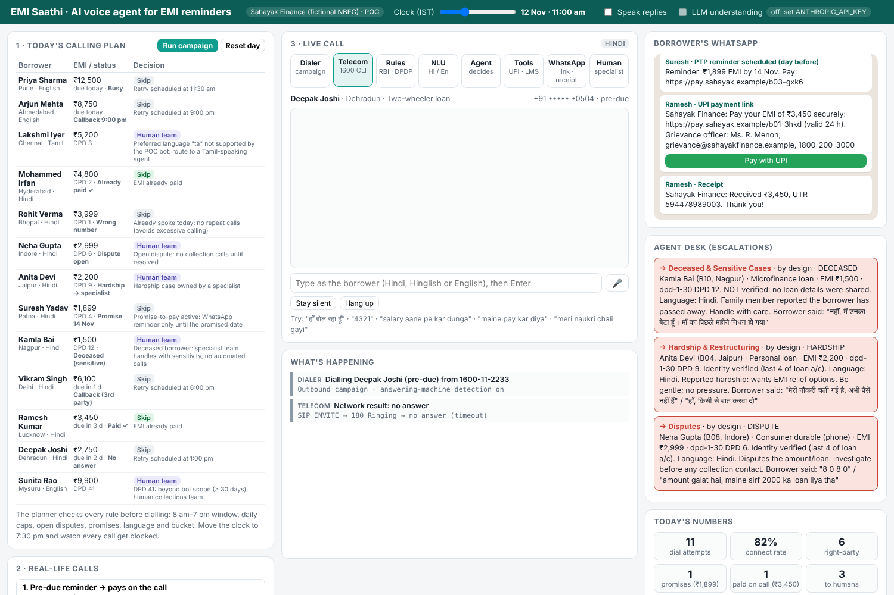

# EMI Saathi: AI voice agent for EMI reminders (India) · POC

A working proof of concept of the most in-demand voice AI use case in Indian lending: an AI agent that
calls borrowers about their EMIs in **Hindi, Hinglish or English**, takes payment through a **UPI link on
WhatsApp**, records **promises to pay**, treats **hardship** with empathy, and follows the **RBI recovery rules**
by code: 8 am–7 pm calling, recorded calls, no threats, and no loan details shared before identity is verified.



## Why this use case

- Indian NBFCs and banks use GenAI voice bots for EMI reminders, promise-to-pay capture and payment plans in Indian languages ([Appwrk](https://appwrk.com/insights/ai-in-nbfc-lending)).
- Reported cost: about **₹12–25 per AI call vs ₹40–60 per human tele-caller** on early-bucket collections ([Oli AI](https://oliai.in/blog/nbfc-emi-reminder-ai-automation/)).
- **Vernacular matters:** Hindi and regional languages, with natural code-switching, drive pick-up and resolution in Tier-2/3 India ([Helo.ai](https://helo.ai/resources/blog/ai-voice-bot-emi-reminders-loan-collections-bfsi-guide)).
- **New RBI rules** (final directions 6 Aug 2026, effective 1 Jan 2027): recovery contact 8 am–7 pm, calls recorded and kept 6+ months, grievance officer details on every communication ([Exotel summary](https://exotel.com/rbi-loan-recovery-guidelines)).

## Run it in 2 minutes (no installs, no accounts)

```bash
npm start            # (or npm.cmd start)  ->  open http://localhost:3100
```

Port **3100** is used, so it runs alongside the WISMO simulator on 3000. Then:
1. Click **Run campaign** and watch Saathi work through today's list.
2. Click any **real-life call** (12 of them) to watch it slowly, with English translations.
3. Click **Call** next to a borrower and **be the borrower yourself**: type, or press 🎤 to speak Hindi in Chrome or Edge.

Other commands: `npm test` (21 automated checks) · `npm run demo` (all calls in the terminal).

## What the POC does

| Building block | In this POC | In production |
|---|---|---|
| Calling plan | `src/campaign.js`: buckets, priorities, retries, caps | LMS export + Amazon Connect outbound campaigns / Genesys outbound |
| Compliance rules | `src/compliance.js`: 8–7 window, consent for other times, holds, privacy, language auditor | Same code, reviewed by Legal |
| Understanding | `src/nlu.js`: Hindi, Hinglish, English; dates like "salary aane pe", "parso" | + optional LLM classifier (`src/llm.js`) or Nova 2 Sonic |
| Conversation | `src/agent.js`: verify, dues, UPI link, PTP, UTR check, hardship, dispute, bereavement, hand-over | Same agent behind Lex/Connect (`lambda/`) or a voice gateway (Conversation API) |
| Payments | Simulated UPI deep link + webhook | Payment gateway (UPI collect / payment links) |
| WhatsApp | Simulated messages | WhatsApp Business API via a BSP |
| Humans | Agent desk with a summary | Genesys / Connect queue + screen pop |
| Numbers | KPIs + ROI calculator | Data lake dashboard |

## Follow the milestones (hand-holding guide)

**[docs/03-hand-holding-guide.md](docs/03-hand-holding-guide.md)**: start here. Seven milestones, each with steps, "you should see" checks, and fixes.

- [docs/01-the-use-case.md](docs/01-the-use-case.md): the business problem, rules and conversation design
- [docs/02-architecture.md](docs/02-architecture.md): building blocks, from LMS to phone to WhatsApp
- [docs/04-demo-script.md](docs/04-demo-script.md): a 10-minute demo for your manager
- [docs/05-go-real.md](docs/05-go-real.md): real phone calls (Amazon Connect, Genesys, Nova 2 Sonic Hindi)

## Repo map

```
server.js              web server + Conversation API + optional LLM endpoint (no installs)
simulator/index.html   the visual POC
src/data.js            lender, 13 borrowers, ledger, IST time helpers
src/nlu.js             Hindi / Hinglish / English understanding
src/compliance.js      calling rules, privacy guard, language auditor
src/agent.js           the conversation agent (bilingual templates)
src/campaign.js        calling plan, retries, KPIs, ROI
src/scenarios.js       12 real-life calls
src/llm.js             optional LLM-as-classifier (Claude) with strict validation
lambda/index.js        AWS Lambda for Amazon Lex / Connect
test/emi.test.js       21 automated checks
```

All borrowers, numbers and accounts are fictional. This is a POC, not legal advice: have Compliance review the rules.
