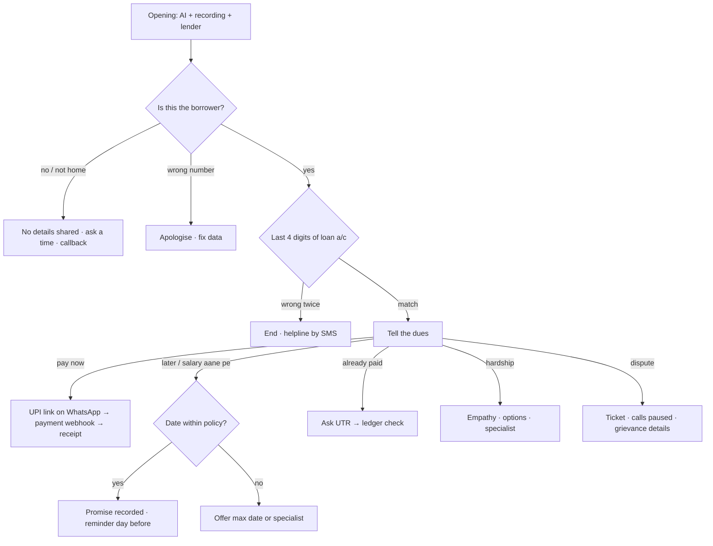

# The use case: EMI reminders and early collections for an Indian NBFC

## 1. The problem
Sahayak Finance (fictional) has lakhs of small loans: two-wheelers, phones, TVs, personal and microfinance.
Every month thousands of EMIs are due. Tele-callers can't reach everyone at the right time, in the right
language, with the right tone. Missed reminders become overdue accounts, then NPAs.

## 2. What the bot does (and doesn't do)

| The bot handles | The bot hands to a person (by design) |
|---|---|
| Pre-due reminders (T-3, T-1), due-day and 1–30 days past due | More than 30 days past due → human collections team |
| Identity check (last 4 digits of the loan account) | Hardship (job loss, illness) → restructuring specialist |
| Telling the dues, sending a UPI link on WhatsApp | Disputes ("amount is wrong") → disputes team, calls paused |
| Recording a promise-to-pay within policy dates | Bereavement → sensitive-cases team, no automated calls |
| Checking "I already paid" against the ledger (UTR) | Requests for a person, repeated confusion, abuse |
| Callbacks, wrong numbers, third parties (no details shared) | Languages the bot doesn't speak yet (e.g. Tamil) |

## 3. The rules, built into code (`src/compliance.js`)

| Rule | Why | How the POC enforces it |
|---|---|---|
| Contact only 8 am–7 pm, other times only at the borrower's request | RBI recovery directions | Planner blocks calls; callbacks outside the window need the borrower's own request, recorded as consent |
| Calls recorded with intimation, kept 6+ months | RBI | Opening line says "this call is recorded"; retention flag on every call |
| No harsh practices (threats, abuse, excessive calls, third-party disclosure) | RBI | Language auditor blocks words like police/jail/legal action; daily caps; no loan details before verification |
| Grievance officer details on communications | RBI | Included in WhatsApp/SMS messages |
| Purpose limitation, minimal data | DPDP Act 2023 | Summaries contain only what the agent needs; no card/OTP data |
| BFSI service calls from 1600-series numbers | TRAI | Caller ID set to a 1600 number |

## 4. Conversation design

Global exits at any point: bereavement, abuse, "talk to a person", "stop calling", language switch.

## 5. How we measure success

| Metric | Meaning |
|---|---|
| Connect rate | Calls answered ÷ dial attempts |
| Right-party contact (RPC) | Conversations with the actual borrower |
| PTP rate and PTP kept | Promises captured, and how many are honoured on time |
| Paid on call | Payments made via the link during the call |
| Escalations by reason | Where humans are needed: improve scripts or policy |
| Complaints | Must not rise vs the human-only baseline |

## 6. The business case
The simulator's "Business case" card estimates monthly savings from your inputs (accounts, cost per human
call, cost per bot call, bot share). Industry figures quoted for India: ₹40–60 per human call vs ₹4–25 per AI call.
