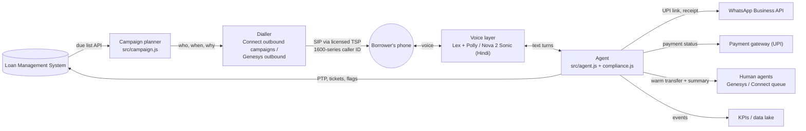

# Architecture: the building blocks of EMI Saathi

## The flow of one real call
1. **Planner** pulls today's due list from the LMS and decides who may be called now (rules in `compliance.js`).
2. **Dialler** places the call. In India it goes out through a **licensed operator's trunk** (Airtel, Tata, Jio…) with a **1600-series caller ID**.
3. **Answering-machine detection** decides human vs voicemail; only humans reach the agent.
4. **Voice layer** turns speech into text (and back). Options:
   - **Amazon Lex + Polly**: classic, structured.
   - **Amazon Nova 2 Sonic**: speech-to-speech, supports **Hindi** (voices *kiara* and *arjun*) and English (India), and can switch language mid-sentence.
5. **Agent** (this repo) runs the conversation turn by turn and calls tools:
   - payment link
   - ledger check
   - PTP, ticket
6. **WhatsApp** delivers the UPI link, receipts, reminders and grievance details.
7. **Humans** get a warm transfer with a summary when needed.
8. **Every event** lands in the KPI store, and **recordings** are retained for at least six months.

## Where the POC code fits in production

| POC file | Production home |
|---|---|
| `src/agent.js`, `src/compliance.js`, `src/nlu.js` | Same code in AWS Lambda (`lambda/`) or a container behind the Conversation API |
| `server.js` Conversation API | Called by a voice gateway (e.g. Genesys Audio Connector bridge, Connect + Lex, or a SIP AI gateway) |
| `src/campaign.js` | Logic feeding Connect outbound campaigns / Genesys outbound lists |
| `src/llm.js` | Bedrock / Anthropic call with guardrails, logging and data-residency review |
| simulated UPI / WhatsApp | Payment gateway webhooks + WhatsApp BSP templates (pre-approved) |

## Data, security and residency
- Keep borrower data in India-region services where possible. Check where the speech/LLM models run: at launch, Nova 2 Sonic was available in US East (N. Virginia), US West (Oregon) and Asia Pacific (Tokyo). That's a key review item for Indian BFSI data.
- Mask PII in logs; summaries carry only what an agent needs.
- Pre-approve every bot sentence (the templates in `agent.js`). The LLM, if used, only classifies.
